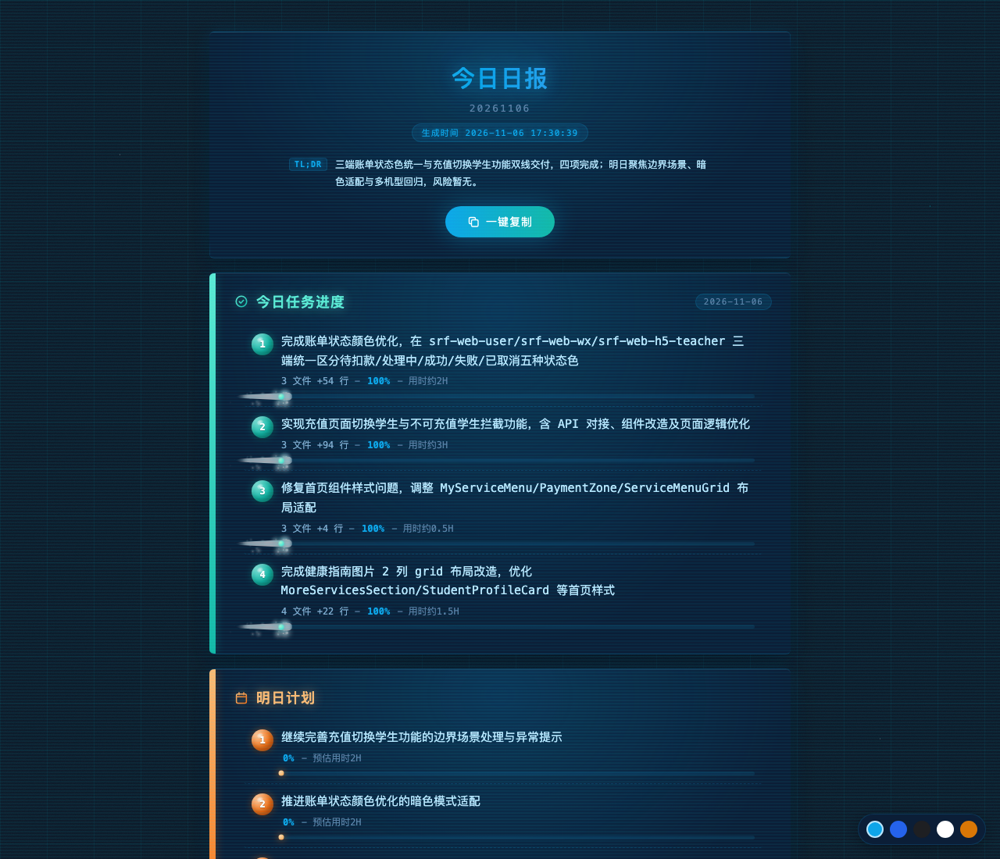
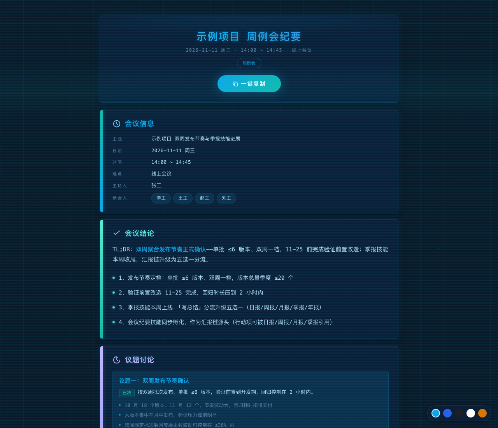
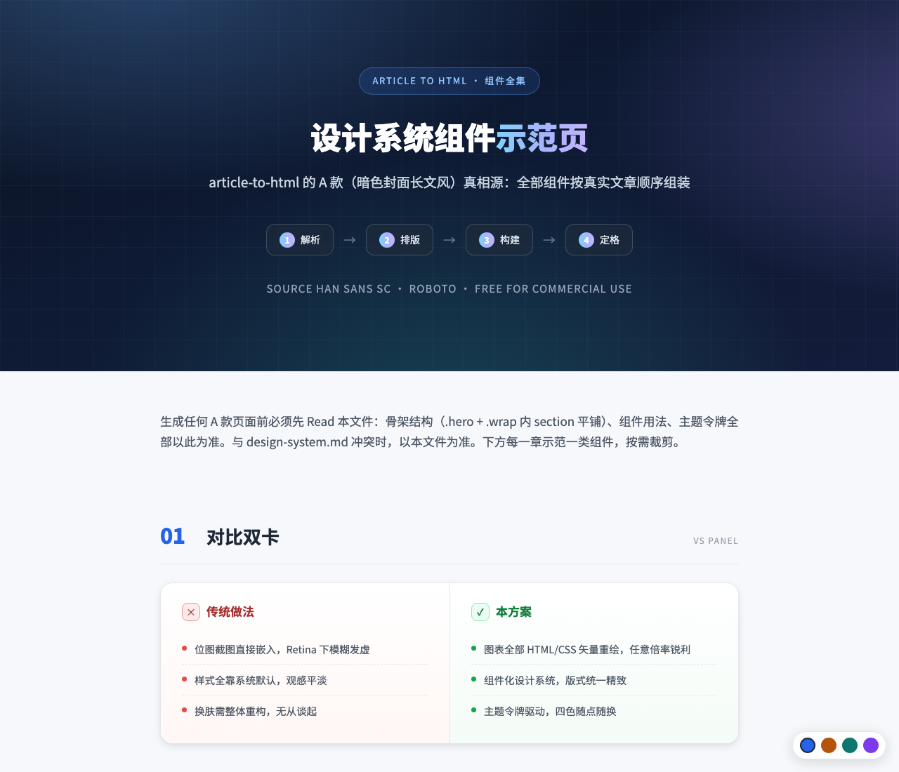
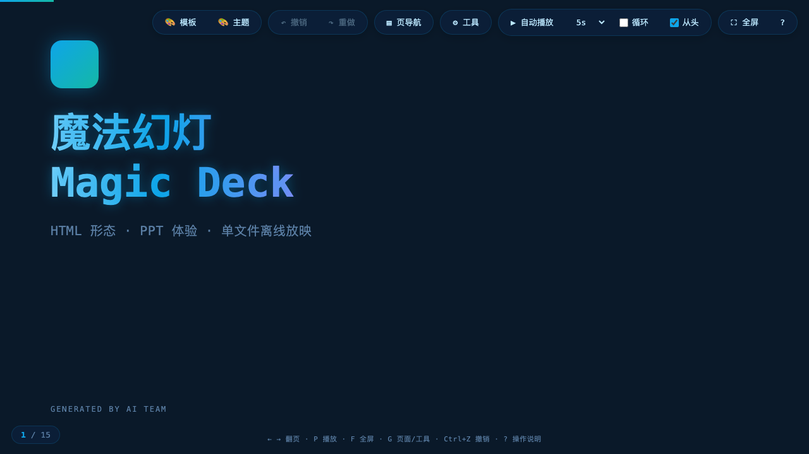
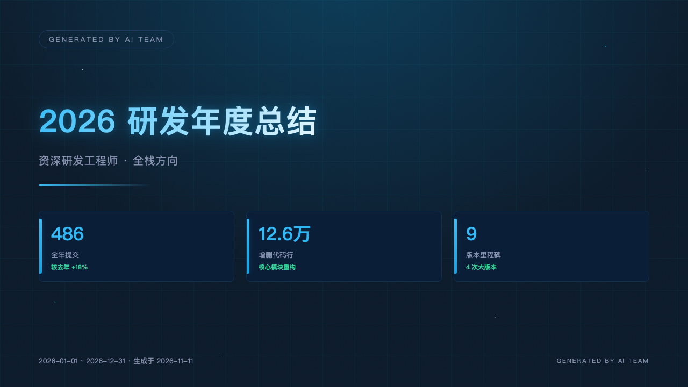
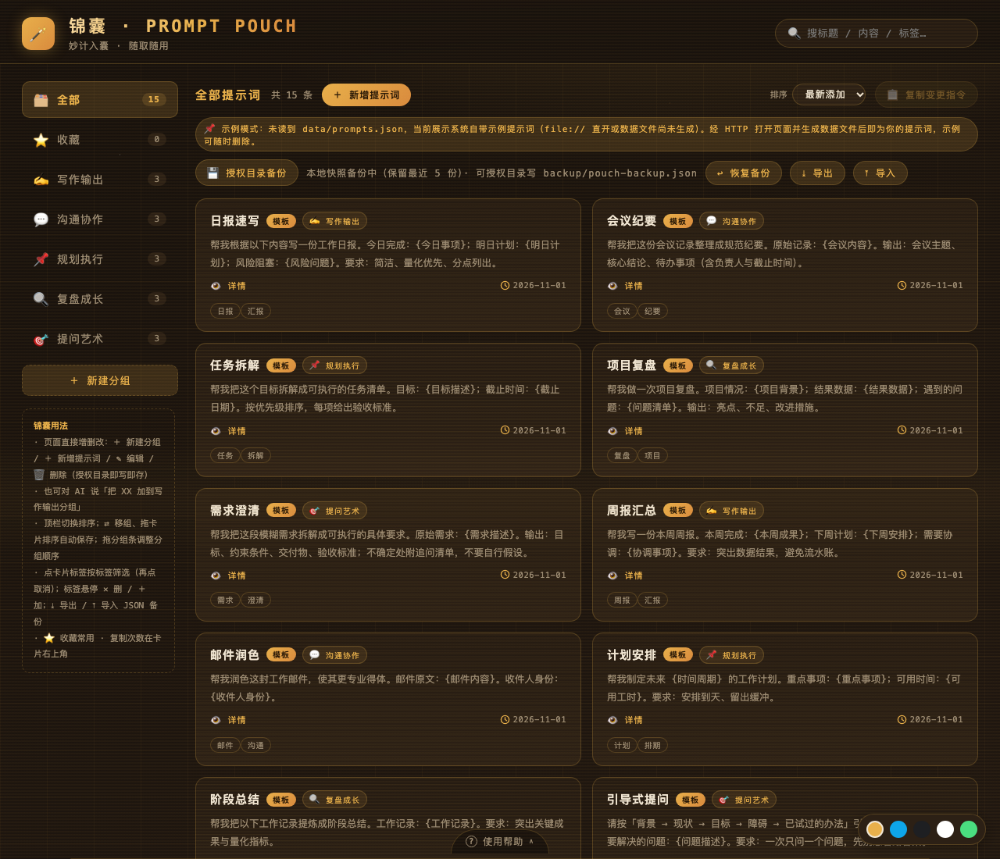

# SkillForge · Skill Smithy

[中文](README.md)

> A workshop that gathers "AI craft" in one place — forging day-in, day-out repetitive labor into handy tools summonable by a single sentence. Every skill in the forge is a set of crafting instructions written for AI: one natural-language phrase calls it up, and it produces standardized output following a fixed procedure. The craft is host-agnostic — swap a thin frontmatter envelope and the same skill travels from one AI assistant to another.

Every skill enters through SKILL.md — the frontmatter, the generation flow, and the config pointer (user-editable config lives in user-config.md, read before every run) stay at the entry, while heavy content is split into resources/ by generation stage (or flat helper files such as design-system.md and scripts/). The AI reads each part only when it reaches that stage, keeping the resident context footprint small.

## Output Gallery

All of the following are real screenshots of actual output produced by these skills.

<table>
<tr>
<td align="center" width="50%">
  <br/>
  <sub>Daily report output page (task progress / tomorrow's plan / risks & blockers, three-section cards)</sub>
</td>
<td align="center" width="50%">
  <br/>
  <sub>Meeting minutes output page (meeting info / conclusions / agenda / action items, five-section cards)</sub>
</td>
</tr>
<tr>
<td align="center" width="50%">
  <br/>
  <sub>Article mounting output page (dark cover + componentized body, charts redrawn as vectors)</sub>
</td>
<td align="center" width="50%">
  <br/>
  <sub>Magic slide deck cover (16:9 stage, presentation + templates + themes)</sub>
</td>
</tr>
<tr>
<td align="center" width="50%">
  <br/>
  <sub>Deck-stage PPTX cover page (lossless HTML capture, natively editable pages)</sub>
</td>
<td align="center" width="50%">
  <br/>
  <sub>Prompt pouch management console (groups / search / favorites / tags / import & export)</sub>
</td>
</tr>
</table>

## Skill Categories

Skills are grouped by "what they ultimately produce" — one skill belongs to exactly one category. Categories exist only for repository organization and navigation; installation always copies skills flat into the target AI assistant's skill directory, regardless of category.

| Category | Description | Skills |
|:---|:---|:---|
| Report showcase | Multi-source data assembly (a paragraph, descriptions in files, images & materials, verbal additions — anything becomes copy) into periodic reports (daily / weekly / monthly / quarterly / annual) and a team daily-report collector | daily-report, weekly-report, monthly-report, quarterly-report, annual-report, team-report-collector |
| Document mounting | Document conversion & beautification: Word / Markdown / plain text → polished HTML + per-chapter screenshots; Chinese ↔ English twin documents; one-page posters | article-to-html, twin-docs, one-pager |
| Engineering efficiency | Pandoc-based document ↔ spec conversion (requirement slicing / spec export to Word·PDF): mechanical Pandoc conversion + AI proofreading against errors; release notes & CHANGELOG generation | spec-doc2spec, spec-spec2doc, release-notes |
| Presentation showcase | From content to presentation: HTML-form magic slides (playback + templates + themes) and .pptx stage decks (natively editable pages + cover captures) | magic-deck, deck-stage |
| Data preparation | Excel / CSV / JSON cleaning into structured data (transparent cleaning steps, full audit trail, overview report) and git commit heatmaps | data-prepper, commit-heatmap |
| Communication & collaboration | Meeting minutes (action items with owners and deadlines, the source of the reporting chain), prompt management (prompt-pouch local console) and decision logs | meeting-minutes, prompt-pouch, decision-log |
| Skill crafting | The meta skill that forges skills themselves (create skills / plugins) and skill health checks | meta-forge, skill-doctor |

## Skill List

| Skill | Category | Directory | Description |
|:---|:---|:---|:---|
| daily-report | Report showcase | [daily-report/](daily-report/) | Multi-source daily reports (today's task progress / tomorrow's plan / risks & blockers): a paragraph, descriptions in files, images, or verbal additions all work; natural-language dates (today / yesterday / last Wednesday / Oct 20); consecutive multi-day batch; custom templates; 12-industry dictionary |
| weekly-report | Report showcase | [weekly-report/](weekly-report/) | Multi-source weekly reports (this week's conclusion + task progress / next week's plan / risks & blockers + weekly overview card); configurable week end (default Friday); natural-language week targeting (this week / last week / 2nd week of October / holiday-anchored) |
| monthly-report | Report showcase | [monthly-report/](monthly-report/) | Multi-source monthly reports (four sections: monthly overview / key achievements / problems & improvements / next month's plan); developer users can aggregate the month's git commits; 12-industry dictionary, custom templates, natural-language month targeting |
| quarterly-report | Report showcase | [quarterly-report/](quarterly-report/) | Multi-source quarterly summaries (four sections: quarter overview / key achievements / problems & improvements / next quarter's plan): core data cards with QoQ (vs last quarter) and YoY (vs last year) dual baselines, overview includes a Q1–Q4 trend chart; achievements in an M1/M2/M3 monthly timeline; 12-industry dictionary, custom templates |
| annual-report | Report showcase | [annual-report/](annual-report/) | Multi-source annual summaries (five sections: year overview / core achievements / experience & growth / shortcomings & reflection / new-year plan): full-year git commit aggregation + verbal input; 12-industry dictionary, custom templates, natural-language year targeting |
| article-to-html | Document mounting | [article-to-html/](article-to-html/) | Word / Markdown / plain text → polished standalone HTML (Source Han Sans SC + Roboto, both free for commercial use; charts redrawn with HTML/CSS), per-chapter screenshots (Retina 2x); a ready-made HTML file can be captured directly or beautified first |
| spec-doc2spec | Engineering efficiency | [spec-doc2spec/](spec-doc2spec/) | Word / Markdown requirement docs → structured requirement slices (thin entry + resources volumes); auto-detects Pandoc and guides cross-platform installation when missing |
| spec-spec2doc | Engineering efficiency | [spec-spec2doc/](spec-spec2doc/) | Markdown specs → Word / PDF deliverables; auto-detects Pandoc and guides cross-platform installation when missing; dual PDF paths (xelatex / Chrome print fallback) |
| magic-deck | Presentation showcase | [magic-deck/](magic-deck/) | Content → single-file HTML slide deck (16:9 stage + playback engine + sixteen layout templates + seventeen themes + 21 domain template packs + five chart animations + animation library + fullscreen pure-playback mode): autoplay/loop/interval, keyboard hotkeys, in-page links, per-page PNG captures and body copying |
| deck-stage | Presentation showcase | [deck-stage/](deck-stage/) | Reports / materials → professional .pptx stage decks: three-question interaction (materials → page skeleton table → build method), regular pages natively editable (data cards / timelines / bar charts / pie charts / line charts), cover & closing pages captured losslessly from HTML, speaker notes per page; visuals share the same source as the report family (tech/biz/mono/light/warm five themes) |
| meta-forge | Skill crafting | [meta-forge/](meta-forge/) | The meta skill: forges complete skill packages from requirements (thin entry + resources split + user-config), auto-embeds the eight mechanisms (CONFIG_VERSION key / user-config extraction / reference dual-track / doc-sync self-check discipline / preserve list / multi-file isolation / infringement-free, desensitized & offline / output reforge upgrades), auto-registers in the README category table, cli.js CATEGORIES and package.json files on repo entry (no skill missing from the npm package) |
| meeting-minutes | Communication & collaboration | [meeting-minutes/](meeting-minutes/) | Multi-source meeting minutes (five sections: meeting info / conclusions / agenda discussion / resolutions & action items / next meeting): action items with owners and deadlines (source of the reporting chain, citable by daily/weekly/monthly/quarterly reports); built-in 12 meeting-type dictionaries, custom templates |
| prompt-pouch | Communication & collaboration | [prompt-pouch/](prompt-pouch/) | Prompt management console: generates and maintains a local HTML management page (group sidebar / search / drag & button sorting / favorites / {variable} interpolation / one-click copy / full tag interactions / JSON import & export / group emoji quick panel), data stored in data/prompts.json with rolling backups in backup/, page and data separated, dual-hand collaboration (direct page edits + AI writing) |

## Quick Start

```bash
npm i -g skill-forge-hub        # global install
skill-forge ls                  # list all skills (read-only)
skill-forge init                # interactive skill picker, auto-detects & installs to your AI assistant's skill directory
skill-forge update              # upgrade installed skills (config-version aware, local config protected)
```

After installation, just say "write a daily report", "write a weekly report", "write a monthly report", "write a quarterly report", "write an annual report", "take meeting minutes", or hand it a document to trigger a skill; asking "how do I use daily-report / meeting-minutes / deck-stage" prints the usage guide.

## Documentation

| Document | Content |
|:---|:---|
| [docs/install.en.md](docs/install.en.md) | Installation & upgrade in depth: both install methods, command reference, upgrade & config-protection mechanics, maintainer conventions (CONFIG_VERSION bump rules). Chinese version [docs/install.md](docs/install.md) |
| [docs/architecture.en.md](docs/architecture.en.md) | Architecture & conventions: directory layout, skill anatomy (thin entry + resources), the eight mechanisms, splitting conventions, general principles. Chinese version [docs/architecture.md](docs/architecture.md) |
| [docs/usage-examples.en.md](docs/usage-examples.en.md) | Skill usage scenario examples: daily-report / prompt-pouch / both PPT forms / meeting-minutes, full chain from install to reforge. Chinese version [docs/usage-examples.md](docs/usage-examples.md) |
| [skillforge-guide](https://windfallsheng.github.io/SkillForge/) | Built-in usage guide (txt + html in every skill's resources/): ask the AI 'how to use skillforge' and it reads the guide and opens the styled page; live hosted guide at the GitHub Pages public URL (permanent) |
| [CHANGELOG.en.md](CHANGELOG.en.md) | Version changelog. Chinese version [CHANGELOG.md](CHANGELOG.md) |

## License

[MIT](LICENSE)
