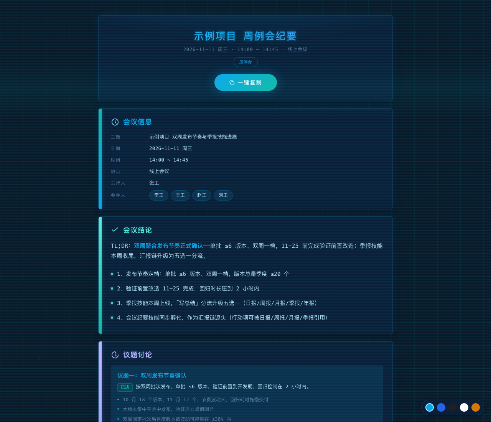
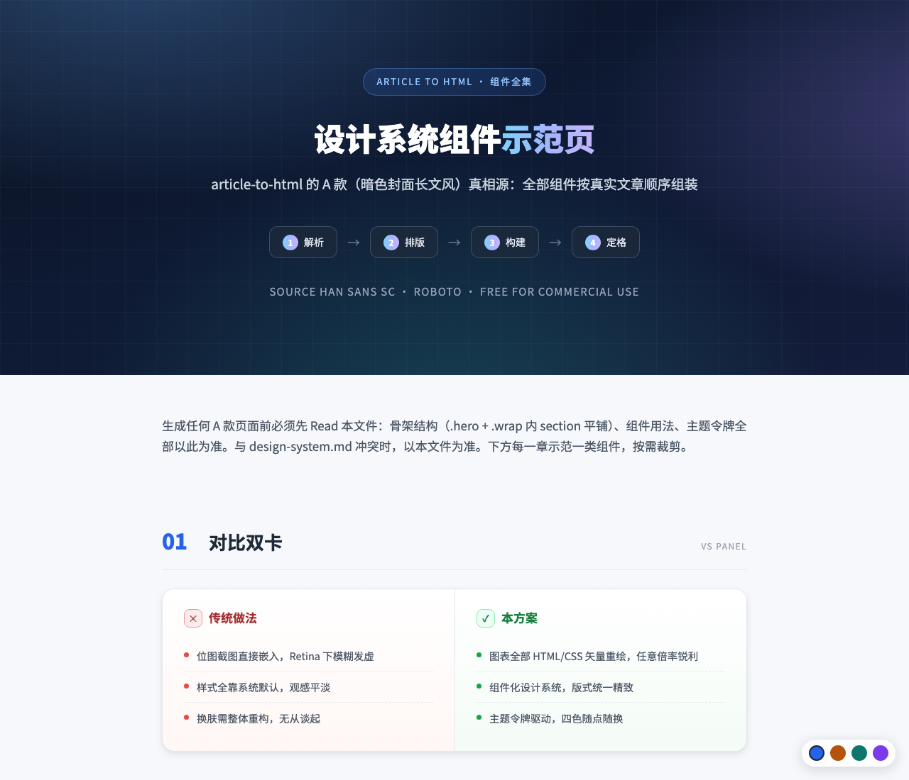
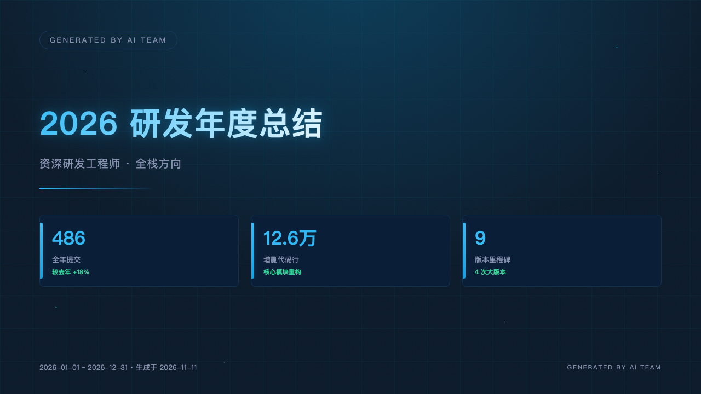
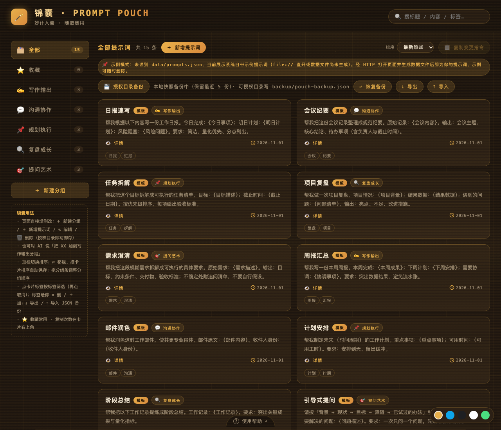

# SkillForge · 技能锻造坊

[English](README.en.md)

> 一处集中收纳「AI 手艺」的工坊——把日复一日的重复劳作，锻造成一句指令就能完成的顺手工具。坊中每一件技能都是一份写给 AI 的手艺说明，一句自然语言即可唤起，按既定工序产出标准化成果；手艺与宿主无关——换一份薄薄的 frontmatter 信封，就能从一位 AI 助手带去另一位。

所有技能均以 SKILL.md 为入口——frontmatter、生成流程、配置指引（用户可改配置出站在 user-config.md，执行前先读）留在入口，重内容按生成阶段拆到 resources/ 或平铺辅助文件（如 design-system.md、scripts/），AI 执行到对应阶段才读取，降低常驻上下文占用。

## 产物画廊

以下均为各技能产出的真实成品截图。

<table>
<tr>
<td align="center" width="50%">
  <br/>
  <sub>日报成品页（任务进度 / 明日计划 / 风险阻塞三段卡）</sub>
</td>
<td align="center" width="50%">
  <br/>
  <sub>会议纪要成品页（会议信息 / 结论 / 议题 / 行动项五段卡）</sub>
</td>
</tr>
<tr>
<td align="center" width="50%">
  <br/>
  <sub>文档装裱成品页（暗色封面 + 组件化正文，图表矢量重绘）</sub>
</td>
<td align="center" width="50%">
  <br/>
  <sub>魔法幻灯封面（16:9 舞台，放映 + 模板 + 主题）</sub>
</td>
</tr>
<tr>
<td align="center" width="50%">
  <br/>
  <sub>登台 PPTX 封面页（HTML 保真截图，原生可编辑页）</sub>
</td>
<td align="center" width="50%">
  <br/>
  <sub>锦囊提示词管理台（分组 / 搜索 / 收藏 / 标签 / 导入导出）</sub>
</td>
</tr>
</table>

## 技能分类

按「技能最终产出什么」归类，一个技能只归一类；分类只用于本仓库组织与导航，安装时始终平铺复制到目标 AI 助手的技能目录，与分类无关。

| 分类 | 说明 | 收录技能 |
|:---|:---|:---|
| 报表汇演 | 多源数据整理（一段文字 / 文件里的描述 / 图片与素材 / 口头补充，什么材料都能成稿），按周期产出报告（日报 / 周报 / 月报 / 季报 / 年报）与团队日报收集台 | daily-report、weekly-report、monthly-report、quarterly-report、annual-report、team-report-collector |
| 文档装裱 | 文档转换与美化：Word / Markdown / 纯文本 → 精美 HTML + 逐章截图；中文 ↔ 英文孪生文档；一页纸海报 | article-to-html、twin-docs、one-pager |
| 工程提效 | 基于 Pandoc 的文档 ↔ 规格互转（需求文档切片 / 规格导出 Word·PDF），Pandoc 机械转换 + AI 校对防错；发版说明与 CHANGELOG 生成 | spec-doc2spec、spec-spec2doc、release-notes |
| 演示汇演 | 从内容到演示：HTML 形态的魔法幻灯（放映 + 模板 + 主题）与 .pptx 登台文稿（原生可编辑页 + 封面截图） | magic-deck、deck-stage |
| 数据整备 | Excel / CSV / JSON 清洗结构化（清洗项明示、每步留痕、概览报告）与 git 提交热力图 | data-prepper、commit-heatmap |
| 沟通协作 | 会议纪要（行动项带负责人与截止时间，汇报链源头）、提示词管理（锦囊本地管理台）与决策日志 | meeting-minutes、prompt-pouch、decision-log |
| 技能自造 | 锻造技能本身的元技能（创建技能 / 插件）与技能体检 | meta-forge、skill-doctor |

## 技能清单

| 技能 | 分类 | 目录 | 说明 |
|:---|:---|:---|:---|
| daily-report | 报表汇演 | [daily-report/](daily-report/) | 多源数据生成日报（今日任务进度/明日计划/风险阻塞点）：一段文字、文件里的描述、图片或口头补充皆可成稿；支持自然语言日期（今天/昨天/上周三/10月20号）、连续多日批量、自定义模板、12 行业词条 |
| weekly-report | 报表汇演 | [weekly-report/](weekly-report/) | 多源数据生成周报（本周结论 + 本周任务进度/下周计划/风险阻塞点 + 本周概览卡）；周结束日可配置（默认周五），支持自然语言周定位（本周/上周/10月第2周/节假日锚定） |
| monthly-report | 报表汇演 | [monthly-report/](monthly-report/) | 多源数据生成月报（四段式：月度概览/本月关键成果/问题与改进/下月计划），开发类用户可聚合当月 git 提交；12 行业职业词典，支持自定义模板与自然语言月份定位 |
| quarterly-report | 报表汇演 | [quarterly-report/](quarterly-report/) | 多源数据生成季度总结（四段式：季度概览/季度关键成果/问题与改进/下季度计划）：核心数据卡带环比（较上季度）+ 同比（较去年同期）双基准，概览附 Q1-Q4 季度走势图；成果段按 M1/M2/M3 月时间线；12 行业职业词典，支持自定义模板 |
| annual-report | 报表汇演 | [annual-report/](annual-report/) | 多源数据生成年度总结（五段式：年度概览/核心成果/经验成长/不足反思/新年规划）：git 全年提交聚合 + 会话口述；12 行业职业词典，支持自定义模板与自然语言年度定位 |
| team-report-collector | 报表汇演 | [team-report-collector/](team-report-collector/) | 团队成员日报收集台：口述 / 文件批量 / 页面导出三种方式收日报 → reports.json 数据真相源 + 单文件离线收集台 HTML（表单填写 + localStorage 草稿 + 导出导入 JSON + 双主题）+ 按日期分组汇总 md |
| article-to-html | 文档装裱 | [article-to-html/](article-to-html/) | Word / Markdown / 纯文本 → 精美独立 HTML（思源黑体 + Roboto 商用免费字体，图表 HTML/CSS 重绘），逐章截图（Retina 2x）；现成 HTML 可直接截图或先美化 |
| twin-docs | 文档装裱 | [twin-docs/](twin-docs/) | 中文文档翻译并同步为英文版（或反向）：术语表一致性对齐、标题层级 / 表格 / 代码块 / 链接逐项对应、双向同步检查出差 |
| one-pager | 文档装裱 | [one-pager/](one-pager/) | 主题 / 一句话想法 → 一页纸 HTML 海报（大标题渐变字 + 金句 + 要点块，纵向一屏、打印友好）+ 可选 PNG 截图，三主题可切换 |
| spec-doc2spec | 工程提效 | [spec-doc2spec/](spec-doc2spec/) | Word / Markdown 需求文档转结构化需求切片（薄入口 + resources 分册）；自动检测 Pandoc，未装引导跨系统安装 |
| spec-spec2doc | 工程提效 | [spec-spec2doc/](spec-spec2doc/) | Markdown 规格导出为 Word / PDF 交付文档；自动检测 Pandoc，未装引导跨系统安装；PDF 双路径（xelatex / Chrome 打印兜底） |
| release-notes | 工程提效 | [release-notes/](release-notes/) | git 两个版本标签之间提交 → 中英双语发版说明 + CHANGELOG 条目（分类归纳 + 用户视角改写 + 提交统计）+ npm 发布前自检清单 |
| magic-deck | 演示汇演 | [magic-deck/](magic-deck/) | 内容 → 单文件 HTML 幻灯（16:9 舞台 + 播放引擎 + 十六套版式模板 + 十七套主题 + 领域成套模板 21 套 + 图表动画五式 + 动画库 + 全屏放映纯净模式）：自动播放/循环/间隔、键盘热键、页内连接、逐页 PNG 截图与主体复制 |
| deck-stage | 演示汇演 | [deck-stage/](deck-stage/) | 报告/素材 → 专业 .pptx 登台文稿：三问交互（素材 → 页骨架表 → 成片方式），常规页原生可编辑（数据卡/时间线/柱图/饼图/折线），封面与结尾页 HTML 截图保真，每页可带演讲备注；视觉与报表同源（tech/biz/mono/light/warm 五主题） |
| data-prepper | 数据整备 | [data-prepper/](data-prepper/) | Excel / CSV / JSON 散装数据清洗为结构化数据：格式探测 → 清洗（清洗项明示、逐条留痕、不猜不编）→ JSON/CSV 落盘 → 数据概览报告（字段画像 / 分布 / 异常值 / 清洗清单） |
| commit-heatmap | 数据整备 | [commit-heatmap/](commit-heatmap/) | git 近一年提交 → GitHub 风格提交热力图 HTML（53 周×7 天格子五档深浅 + 总提交数/最长连续天数/活跃占比/最活跃日统计卡），离线零依赖、三主题切换 |
| meta-forge | 技能自造 | [meta-forge/](meta-forge/) | 元技能：从需求出发锻造完整技能包（薄入口 + resources 拆分 + user-config），自动植入八大机制（CONFIG_VERSION 钥匙 / user-config 抽离 / reference 双轨 / 自检纪律 / preserve 保护清单 / 多文件隔离 / 零侵权脱敏离线 / 产物升级回炉），入仓库时自动登记 README 分类表、cli.js CATEGORIES 与 package.json files（npm 包内容不遗漏） |
| skill-doctor | 技能自造 | [skill-doctor/](skill-doctor/) | 技能体检：对技能目录跑静态检查（frontmatter 与目录名一致 / 资源引用可达 / 配置版本 / 占位符残留 / HTML 技能字体脱敏与多文件隔离与版本戳），三段式体检报告带文件行级定位 |
| meeting-minutes | 沟通协作 | [meeting-minutes/](meeting-minutes/) | 多源材料生成会议纪要（五段式：会议信息/会议结论/议题讨论/决议与行动项/下次会议）：行动项带负责人与截止时间（汇报链源头，可被日报/周报/月报/季报引用）；内置 12 类会议类型词典，支持自定义模板 |
| prompt-pouch | 沟通协作 | [prompt-pouch/](prompt-pouch/) | 锦囊提示词管理台：生成并维护本地 HTML 管理页面（分组侧栏/搜索/拖拽与按钮排序/收藏/{变量}插值/一键复制/标签全交互/导入导出 JSON 备份/分组 emoji 快捷面板），数据存 data/prompts.json、滚动备份在 backup/ 子目录，页面与数据分离，双笔协作（页面直写 + AI 代笔） |
| decision-log | 沟通协作 | [decision-log/](decision-log/) | 重要决策四元组日志（结论 / 取舍权衡 / 被否方案 / 适用与失效条件）：按主题聚合落盘、INDEX 索引、随时检索复盘 |

## 快速开始

```bash
npm i -g skill-forge-hub        # 全局安装
skill-forge ls                  # 列出全部技能（只读）
skill-forge init                # 交互式挑选技能，自动探测并安装到 AI 助手技能目录
npm update -g skill-forge-hub   # 官方发新版后升级 CLI 本体（只升级本包）
skill-forge update              # 升级已安装技能（配置版本感知，本地配置受保护）
```

安装后直接说「写日报」「写周报」「写月报」「写季报」「写年报」「记会议」或丢给它一个文档即可触发；问「日报怎么用 / 会议纪要怎么用 / 登台怎么用」等输出使用说明。

## 文档导航

| 文档 | 内容 |
|:---|:---|
| [docs/install.md](docs/install.md) | 安装与升级详解：两种安装方式、命令参考、升级与配置保护机制、维护者约定（CONFIG_VERSION 递增规则）。英文版 [docs/install.en.md](docs/install.en.md) |
| [docs/architecture.md](docs/architecture.md) | 架构与规范：目录结构、技能形态（薄入口 + resources）、八大机制、拆分规范、通用原则。英文版 [docs/architecture.en.md](docs/architecture.en.md) |
| [docs/usage-examples.md](docs/usage-examples.md) | 技能使用场景示例：日报 / 锦囊 / PPT 两形态 / 会议纪要的安装到回炉全链路。英文版 [docs/usage-examples.en.md](docs/usage-examples.en.md) |
| [skillforge-guide](https://windfallsheng.github.io/SkillForge/) | 内置使用指引（每个技能 resources/ 均含 txt + html 双版）：对 AI 说「skillforge 怎么用」即朗读指引并打开排版页；在线引导页见 GitHub Pages 公网地址（长期有效） |
| [CHANGELOG.md](CHANGELOG.md) | 版本变更记录。英文版 [CHANGELOG.en.md](CHANGELOG.en.md) |

## 许可证

[MIT](LICENSE)
