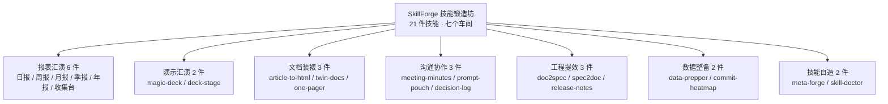
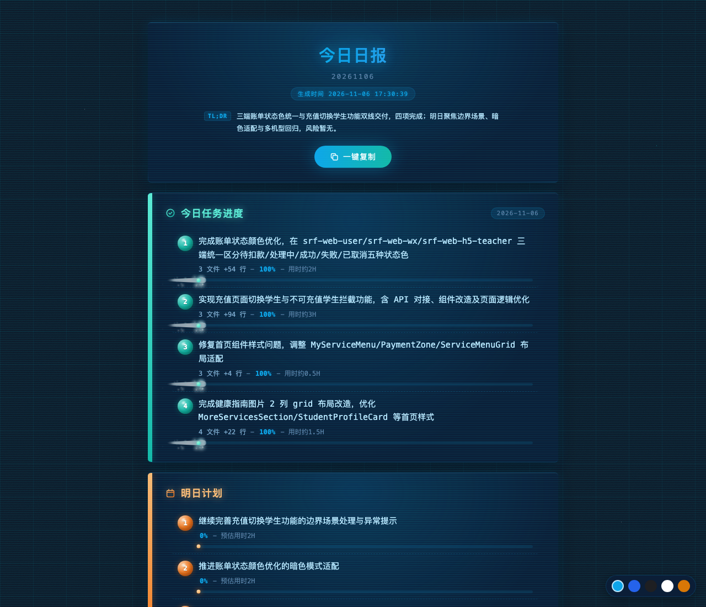
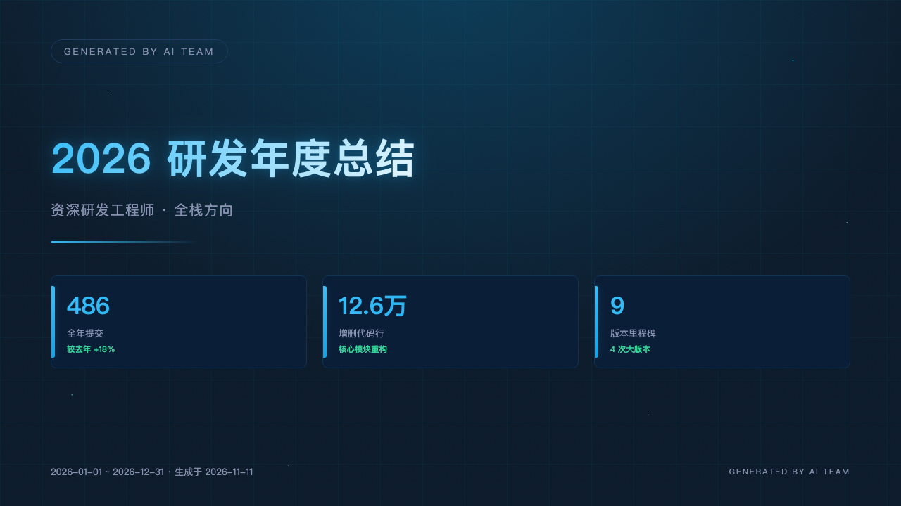
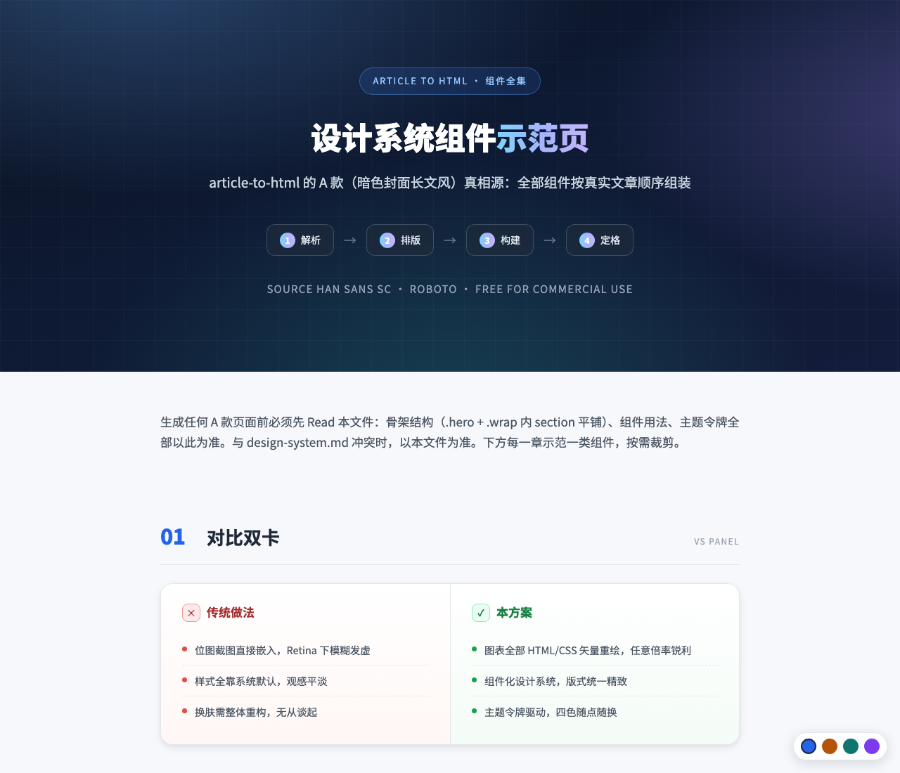
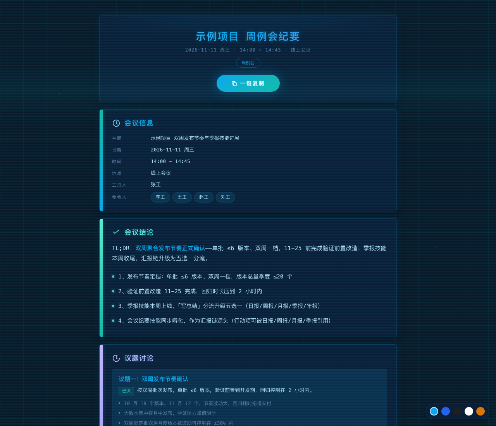
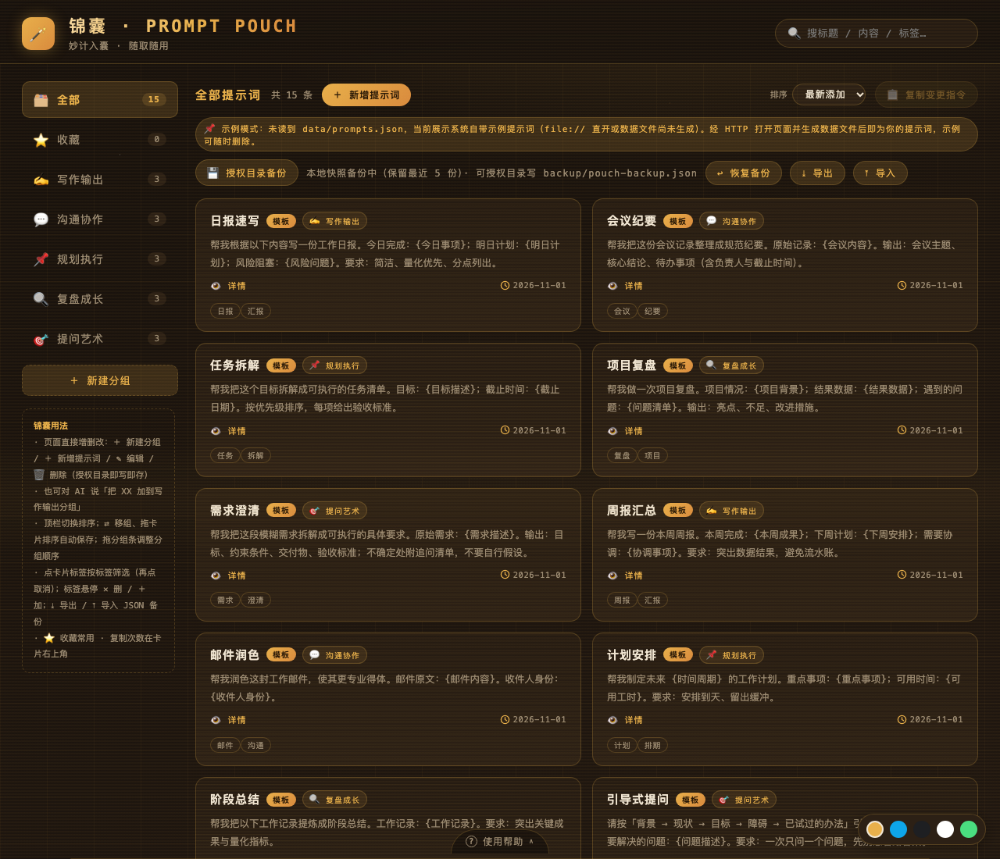
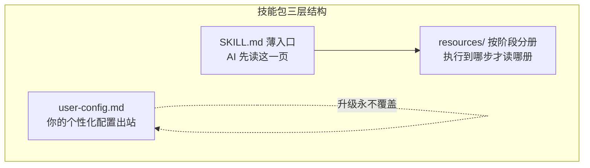

# 别再从零教 AI：我把 21 种重复劳动，锻成了开箱即用的技能包

> 项目：SkillForge（技能锻造坊） · 开源协议：MIT · 仓库：https://github.com/windfallsheng/SkillForge
> 一句话安装：`npm i -g skill-forge-hub && skill-forge init`


*说一句「做个 PPT」，魔法幻灯直接生成可全屏放映的 HTML 幻灯——这就是技能包的打开方式。*

## 一、一个熟悉的场景

你一定经历过：让 AI 写日报，它这次三段、下次五段；让它做 PPT，封面风格全靠运气；上个月调教好的「完美提示词」，这个月翻遍聊天记录也找不回来。

问题不在 AI 不够聪明，而在**每次对话都是零上下文起跑**。AI 记得住你上一句话，记不住你上个月的偏好。

于是有了 SkillForge——一个「AI 手艺」的锻造坊：把日复一日的重复劳作，锻造成一句指令就能完成的顺手工具。每个技能都是一份写给 AI 的手艺说明：入口薄薄一张 SKILL.md，重内容按阶段拆成资源分册，AI 执行到哪一步才读哪一册，上下文占用极小。

## 二、21 个技能，七个车间

目前工坊里锻造了 21 件技能，按「最终产出什么」分七类：



### 1. 报表汇演（6 件）——从一句话到五件套汇报

日报、周报、月报、季报、年报五件套 + 团队日报收集台。共同的本事：

- **多源成稿**：一段口述、一份文件、一张图片、几句补充，什么材料都能整理成稿；
- **12 行业职业词典**：开发写「联调、回归」，产品写「验收、迭代」，话术不跑偏；
- **自然语言日期**：「昨天的日报」「上周三的日报」直接定位，连续多日还能批量；
- **三件套落盘**：对话给 md 正文 + 落盘 HTML 页面 + PNG 截图，贴群聊、发邮件各有形态。

季报带环比同比双基准，年报五段式含新年规划，团队收集台能把成员的日报收拢成按日期分组的汇总。**同一套口述习惯，打通整条汇报链。**



*日报「今日任务进度」四格进度条与「明日计划」一眼看完——说一句「昨天的日报」，它就自己写完。*

### 2. 演示汇演（2 件）——PPT 的两副面孔

- **magic-deck**：内容 → 单文件 HTML 幻灯。16:9 舞台、十六套版式模板、十七套主题、21 套领域模板，自动播放、键盘热键、全屏纯净放映；
- **deck-stage**：报告 → 原生可编辑的 .pptx。常规页用 PptxGenJS 生成（数据卡、时间线、柱图、饼图可二次编辑），封面结尾页 HTML 截图保真，每页带演讲备注。

一个适合演示效果，一个适合交付修改，说「做个 PPT」它自会问你要哪种。



*deck-stage 生成的 .pptx 数据页：数字卡、图表全部原生可编辑，交付出去还能改。*

### 3. 文档装裱（3 件）——让文档体面地走出去

- **article-to-html**：Word / Markdown / 纯文本 → 精美独立 HTML（思源黑体 + Roboto 商用免费字体），图表用 HTML/CSS 矢量重绘，再逐章截出 Retina 2x 高清图；
- **twin-docs**：中文文档翻译并同步为英文版（或反向），术语表对齐、标题层级逐项对应、双向同步检查；
- **one-pager**：一句话想法 → 一页纸 HTML 海报。**32 套布局模板（含水墨、红金宫廷、青绿山水等国风）× 25 套配色主题 = 800 种版式**，主题坞悬停即显主题名，?shot 参数一键截 PNG。



*article-to-html 把 Word 文章装裱成组件化 HTML 长文：图表矢量重绘、任意倍率锐利，四色随点随换。*

### 4. 沟通协作（3 件）——把碎片收进体系

- **meeting-minutes**：口述材料 → 五段式会议纪要，行动项带负责人与截止时间——汇报链的源头，可被日报周报引用；
- **prompt-pouch**：本地提示词管理台。分组、搜索、收藏、标签、{变量} 插值、导入导出备份，好提示词从此有了回得来的家；
- **decision-log**：重要决策四元组日志（结论 / 取舍 / 被否方案 / 适用条件），随时检索复盘。



*五段式会议纪要：结论 TL;DR 一句看清，行动项带负责人与截止时间，随手可被日报周报引用。*



*锦囊提示词管理台：分组、标签、收藏、{变量} 插值一应俱全，调教好的提示词从此有了回得来的家。*

### 5. 工程提效（3 件）——文档与代码之间

- **spec-doc2spec**：Word/Markdown 需求文档 → 结构化需求切片（Pandoc 机械转换 + AI 校对防错）；
- **spec-spec2doc**：Markdown 规格 → Word/PDF 交付文档；
- **release-notes**：git 两个版本标签之间的提交 → 中英双语发版说明 + CHANGELOG 条目。

### 6. 数据整备（2 件）——把散装数据收拾利落

- **data-prepper**：Excel/CSV/JSON 清洗结构化，清洗项明示、每步留痕、不猜不编，附数据概览报告；
- **commit-heatmap**：git 近一年提交 → GitHub 风格热力图（53 周 × 7 天格子 + 统计卡），离线零依赖。

### 7. 技能自造（2 件）——工坊的自我复制

- **meta-forge**：从需求出发锻造新技能的元技能，自动植入配置保护、版本钥匙、双轨文档等八大机制；
- **skill-doctor**：给技能目录做体检，frontmatter、资源引用、占位符残留逐项静态检查，报告行级定位。

## 三、为什么是「技能」而不是「提示词」

提示词是一次性的对话；技能是**可移植的手艺**：



1. **宿主中立**：换一份薄薄的 frontmatter 信封，同一份技能就能从 Qoder 带去 Claude Code、Cursor——不绑定任何厂商；
2. **配置保护**：你的个性化配置出站在 user-config.md，升级技能永不覆盖；配置结构变化时先备份再三选一；
3. **版本感知回炉**：模板升级后说一句「把我旧日报都升级成新样式」，旧产物批量换新，旧版先备份；
4. **零依赖离线**：全部技能离线可用，不联网、不传数据，产物留在你自己的目录里。

## 四、一分钟上手

```bash
npm i -g skill-forge-hub   # 全局安装 CLI
skill-forge ls            # 浏览 21 件技能（只读）
skill-forge init          # 交互挑选，自动探测 AI 助手技能目录
```

装完直接对话触发：「写日报」「写周报」「记会议」「做个 PPT」「做张海报」，或者干脆丢给它一个文档。

升级同样轻松：`npm update -g skill-forge-hub` 升 CLI 本体，`skill-forge update` 升技能——升级清单支持 a=全部 / 编号挑选 / q=取消，你的配置全程受保护。

## 五、写在最后

AI 时代最贵的不再是「知道什么」，而是「把会做的事稳定复现」。SkillForge 的每一件技能，都是一次被验证过的调教被固化成了永久工艺——今天调好的手感，明天、下个月、换台机器、换个助手，都还在。

仓库已开源（MIT），21 件技能双语简介见 [SKILLS_CATALOG.md](https://github.com/windfallsheng/SkillForge/blob/main/SKILLS_CATALOG.md)，另有两篇实操文章（《用 AI 技能包管提示词》《AI 写日报的正确姿势》）见 docs/articles/。欢迎 Star、试用、一起锻造。
