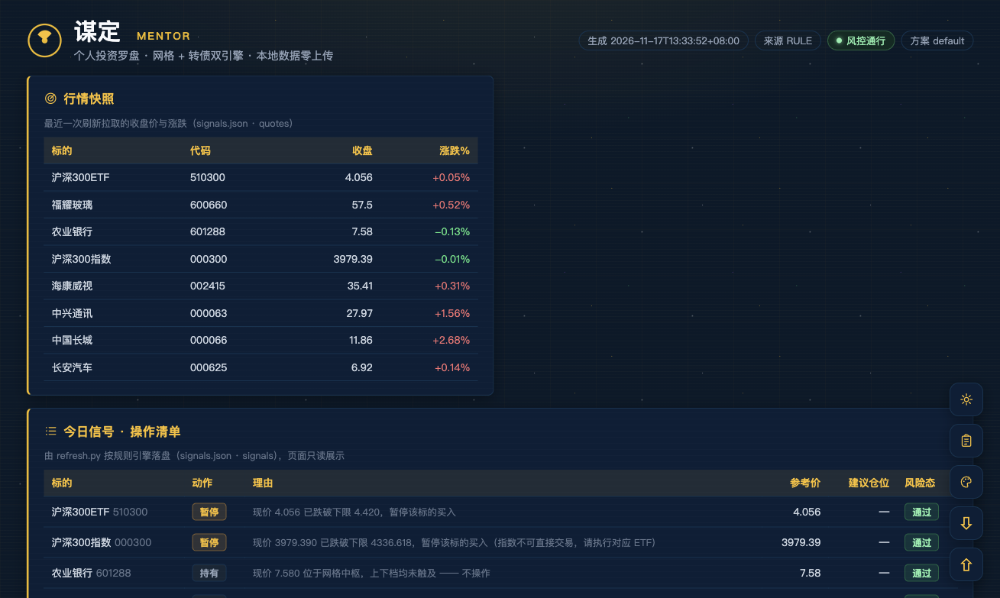
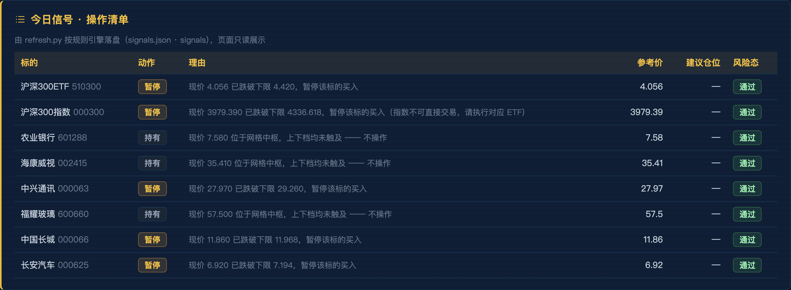
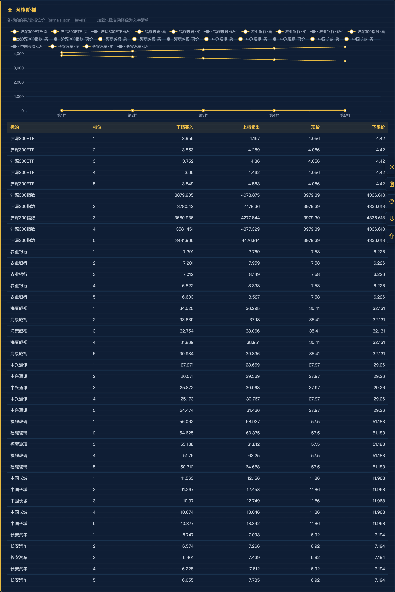
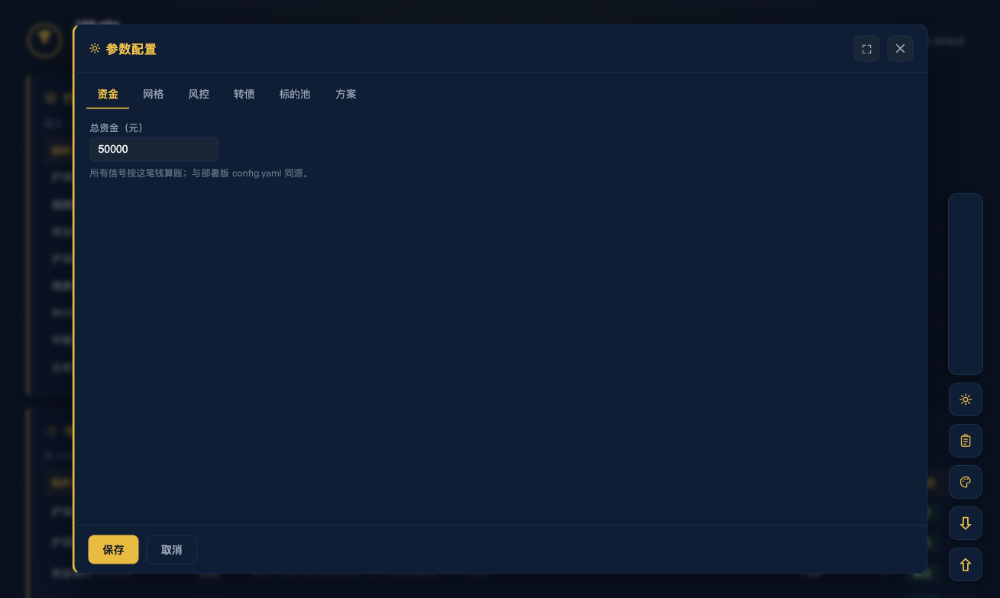
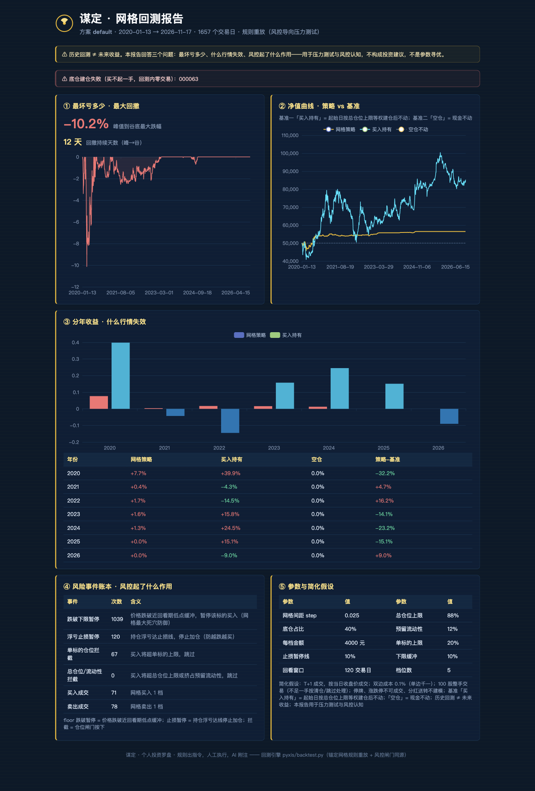

# 谋定而后动：给你的投资上一道风控闸门

> 本地生长的个人投资罗盘——谋定（mentor），无账号、无上传，规则出指令、人工执行、AI 附注。

## 一、亏钱大多死于「乱」

散户账户的亏损，很少死于「不知道买什么」，大多死于「乱」：

- 涨一点就想卖，跌一点就想补，全凭感觉；
- 仓位越加越重，说好的纪律在情绪面前一文不值；
- 每次操作都有理由，但每个理由都是事后编的。

你不是缺信息，是缺一套**动手之前就写死、动手之后不改口**的规矩。谋定做的事，就是替你把这套规矩落在纸面上：参数你定，信号它算，执行仍是你——中间隔着一层 AI 附注。

## 二、它是什么

谋定是一个**本地单文件投资看板**：一个网页、四份 JSON 数据文件，没有服务器、没有账号、不上传任何数据。所有数据存在你电脑的 `~/mentor/` 里，纯文本可读可改。

*▲ 主页全貌：顶部状态栏（生成时间 / 风控通行 / 当前方案），行情快照、今日信号、持仓组合、网格阶梯等八个区块*

它和市面工具最大的不同：**它不替你下单，只给你一份带理由的操作清单**。

- 一句「刷新信号」：拉取行情 → 按你的网格参数与风控闸门计算 → 落盘信号，页面刷新即见；
- 每一条操作都带理由：「现价 4.056 已跌破下限 4.420，暂停该标的买入」——买、卖、暂停、观察，条条有据；
- 风控先行：预留流动性、总仓位上限、单标的上限、floor 下限缓冲、浮亏止损——五道闸门，任何一道拦下，信号就标「拦截」。

## 三、动嘴就够的几种日常

- **刷新信号**：「刷新信号」——拉数、计算、落盘一条链自动跑完，回来看清单；
- **回填持仓**：右下角「持仓回填」把实际持仓填进去，总资产、仓位、组合盈亏自动联动；
- **换方案**：「换成新手稳健方案」——网格步长、仓位上限、止损线整套参数一键切换（另存 / 删除 / 恢复都在方案匣里）；
- **跑回测**：「跑一下回测」——把当前这套参数丢回历史重放，出一份独立的 HTML 回测报告。

*▲ 今日信号：每条操作带理由与风险态徽章（通过绿 / 观察琥珀 / 拦截红）*

## 四、值得安利的几个点

### 1. 七套主题，审美不将就

夜空金、科技蓝、暖棕金、薄荷绿、纸张白、牛市红、终端绿，右下角换肤坞一点即换；行情红涨绿跌，贴合 A 股习惯。

### 2. 风控闸门是主角，不是摆设

单标的上限、总仓位上限、预留流动性、floor 下限缓冲、浮亏止损暂停——风险态徽章逐条公示「通过 / 观察 / 拦截」。规则出指令、人工执行：**它拦它的，你执行你的**。

### 3. 网格阶梯一目了然

每个标的的买/卖档位价画成阶梯图，现价站在哪一档、上档卖多少、下档买多少，一眼看清。

*▲ 网格阶梯：各标的买/卖档位价 + 现价位置，ECharts 阶梯图*

### 4. 参数配置弹框：改参数不动代码

资金、网格、风控、转债、标的池、方案，六个页签改完即存——所有规则阈值都在页面上调，不碰一行代码。

*▲ 参数配置弹框：六个页签改完即存，规则阈值全部页面化*

### 5. 回测：拿历史当压力测试

回测不是预测收益，是回答三个问题：**最坏亏多少、什么行情失效、风控起了什么作用**。锚定网格规则重放 + 与实盘同源的风控闸门，产出独立 HTML 报告——回撤曲线、净值对比（策略 vs 买入持有 vs 空仓）、分年收益、风险事件账本，一页看全。

拿默认参数在 2020-01 至 2026-11 的 6.8 年真实行情上重放：策略总收益 +12.9%、最大回撤 -10.2%（持续 12 天），而同期买入持有 +70.9%。**这份「难看」的账本恰恰是回测的价值**：它如实暴露出 floor 下限缓冲对低波动标的拦得几乎全天候（暂停 1039 次 vs 买入成交 71 次）——参数该不该调，数据说了算，而不是拍脑袋说了算。

*▲ 回测报告：最大回撤、净值曲线、分年收益、风险事件账本、参数与假设一页看全*

### 6. 数据在自己手里

四份 JSON 随时导出备份、换电脑导入恢复；删改有自动滚动备份兜底。没有账号，没有云端，数据出不了你的机器。

## 五、上手三步

1. 对 AI 说「建一个谋定看板」——页面、数据、图表资产自动落盘并起本地服务（手动也简单：`python3 -m http.server` 后访问页面）；
2. 说「刷新信号」——拉行情、出首批操作清单；
3. 说「跑一下回测」——把当前参数丢回历史，看最坏能亏多少。

## 六、写在最后

投资最贵的东西不是信息，是**纪律**。谋定不预测涨跌，也不替你下单——它只做一件事：把你的规矩写死在参数里，把每一次该不该动手，变成一条有据可查的指令。

**先胜而后求战，谋定而后动。**
