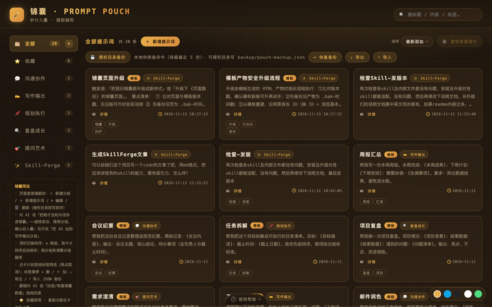
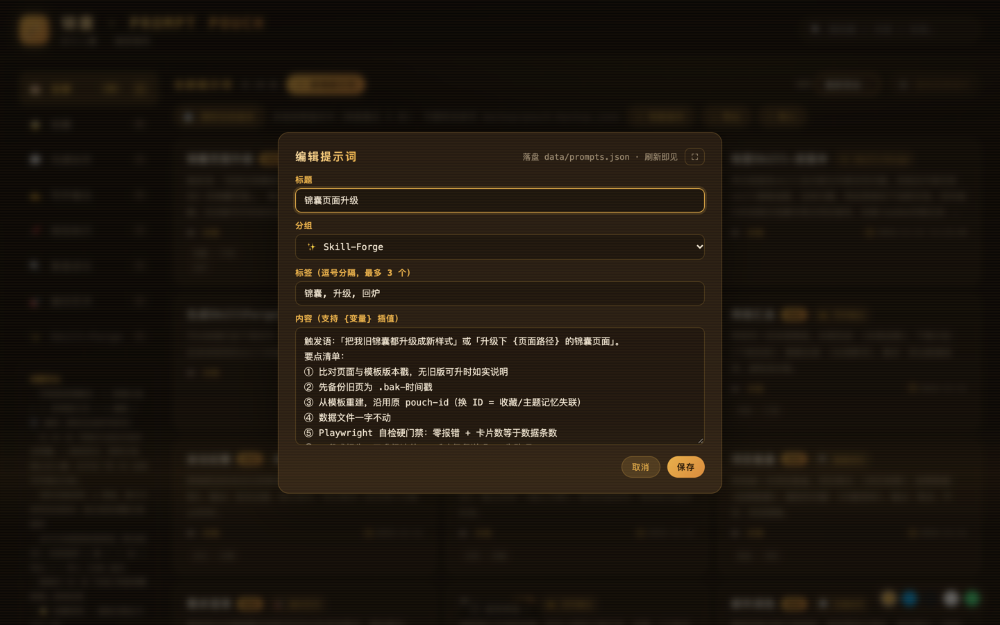
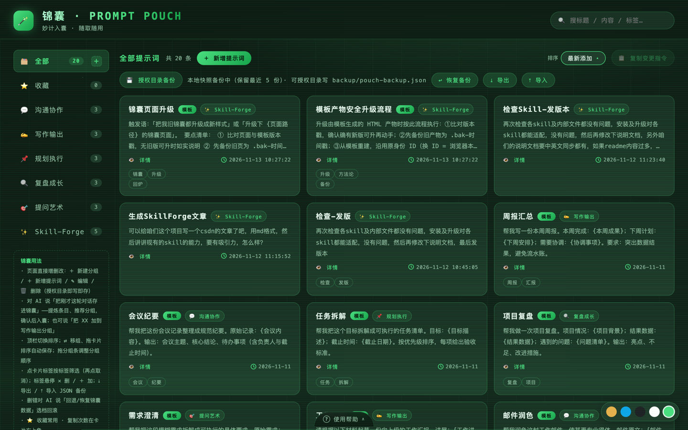
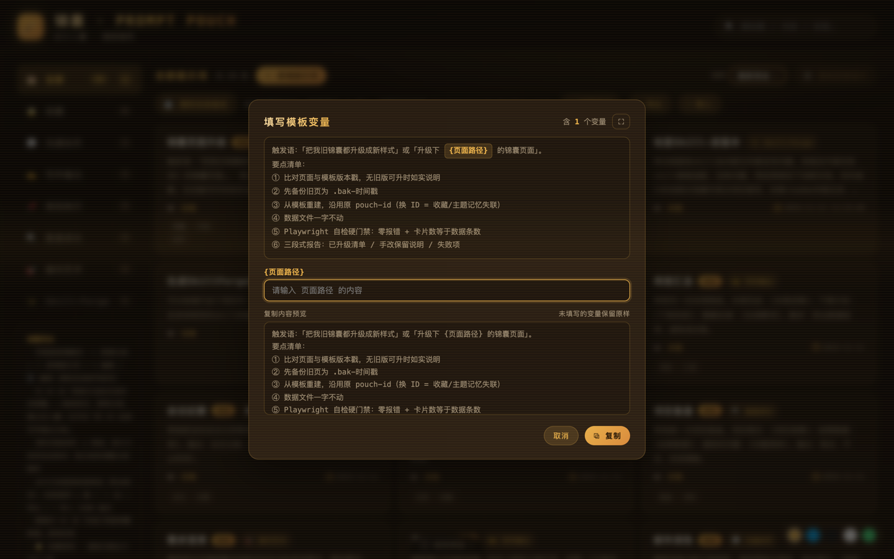
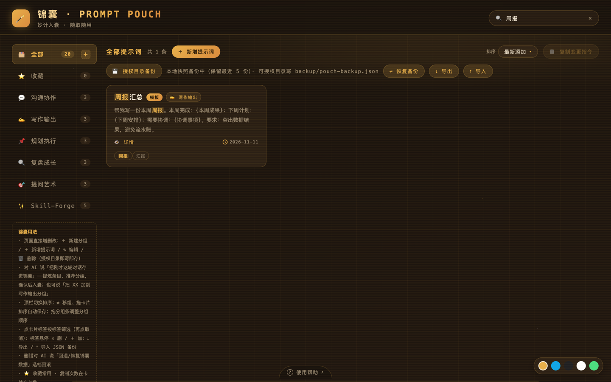
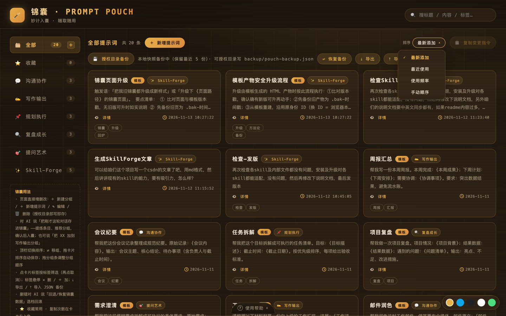
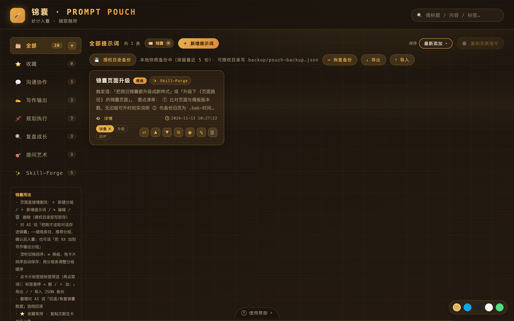
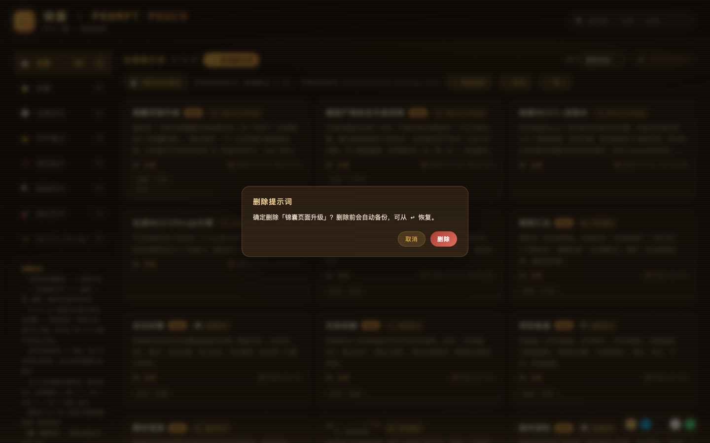
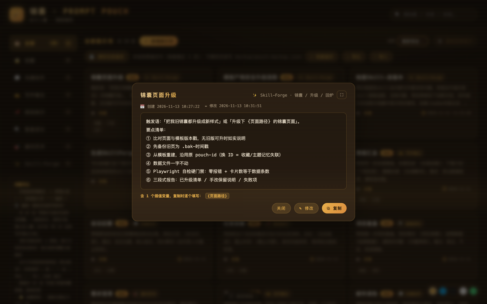
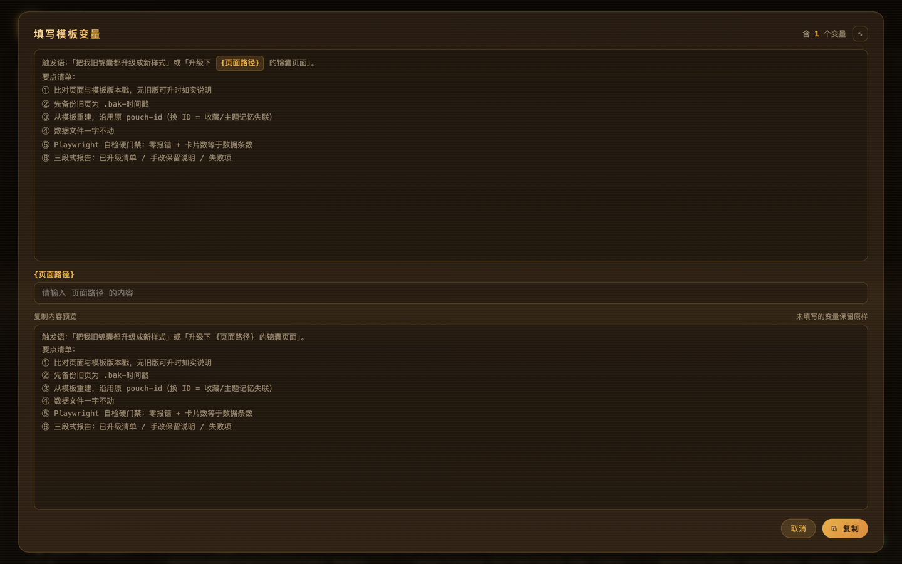

# 妙计入囊：把用过的好提示词，真正留下来

> 本地生长的 AI 提示词口袋——锦囊（prompt-pouch），无账号、无订阅，数据在你自己手里。

## 一、好提示词，大多死于「用过即忘」

用 AI 的日子久了，你大概攒过不少「灵光一现」的用法：

- 那版写周报的提示词，第一次调出来效果惊艳；
- 那套会议纪要的格式，客户看了都夸专业；
- 那个「结论先行」的汇报模板，救过你无数个 Deadline。

然后呢？它们沉在越来越长的对话记录里、躺在备忘录的角落里。真到要用的时候，你只记得「好像有这么个东西」，翻十分钟找不到，只好从头再调一遍。

对话记录是流水，好用法是沙金——没人打捞，就白白冲走了。锦囊做的事，就是让每一句好用法真正「留下来、找得到、用得上」。

## 二、它是什么

锦囊是一个**本地 HTML 提示词管理台**：一个网页、一份 JSON 数据文件，没有服务器、没有账号、没有订阅。所有提示词都存在你电脑的 `data/prompts.json` 里，纯文本可读可改，打开页面即见。

*▲ 管理台全景：左侧分组侧栏带计数徽章，右侧卡片网格，顶栏搜索、排序、导入导出*

它最特别的地方在于：**管理它的人不只有你，还有你的 AI。** 页面与数据分离，双笔协作——页面可直写、AI 可代笔，你只管说，刷新即见。

## 三、动嘴就够的几种日常

- **入囊**：「把刚才这段对话存进锦囊。」AI 会把对话提炼成条目，自动打上标签、建议把具体词泛化成 `{变量}`，分组归位，你确认一次就落盘。
- **取用**：「锦囊里有什么适合写产品周报的？」AI 先查后用——命中就套用模板执行，没命中就正常干活，干完轻轻问一句「要不要入囊」。
- **调优**：「这条不好用，帮我改。」AI 给改版对照，你点头才落盘；用完说「这条好用」，顺手记一行使用心得，下次取用有据可依。

*▲ AI 代笔改好，弹窗里对照确认，点头才落盘*

## 四、值得安利的七个草点

### 1. 五套主题，审美不将就

暖棕金、深蓝科技、IDEA 黑亮、IDEA 白亮、薄荷绿，右下角换肤坞一点即换；网格、星点、扫描线、光带四层科技氛围，与日报、周报、年报同源，像同一家族的器物。

*▲ 同一条数据换身衣服：图为薄荷绿，右下角换肤坞一点即换*

### 2. `{变量}` 插值，一次写成万次复用

正文里的花括号占位自动变成填充面板——点复制弹出变量输入，实时预览、一键复制。模板从此是活的，人名日期换一换，下次照样用。

*▲ 点「复制」弹出填充面板，变量逐个输入，实时预览、一键复制*

### 3. 找得到

搜索关键词高亮、标签点击即筛、四种排序（最新添加 / 最近使用 / 使用频率 / 手动拖拽）。用得越勤，排得越前。

*▲ 搜索「周报」：标题、正文、标签同步高亮，一眼锁定*

*▲ 四种排序随时切换，拖拽或 ▲▼ 自动切手动*

*▲ 点标签即筛选，顶栏胶囊一键清除，可与搜索叠加*

### 4. 删错不怕

数据一有变更 2 秒自动备份，AI 代笔落盘前也会留 `.bak-时间戳`；说一声「回退」，列档选档恢复，双保险。

*▲ 删除前有确认，误删有自动备份兜底，说「回退」可列档恢复*

### 5. 换电脑一句话

旧机「⤓ 导出」JSON，新机「⤒ 导入」即复原，分组、标签全带走。

### 6. 详情弹窗有「时间线」

每条提示词的创建、修改、最近使用一目了然——你的锦囊自己会记账。

*▲ 详情弹窗全文滚动查看，时间线记着每次创建、修改、最近使用*

### 7. 长文一键全屏

详情、变量填充、编辑三个弹窗都能一键全屏（96vw × 96vh），长模板一览无余。

*▲ 弹窗一键全屏，长模板不必在小窗口里翻来翻去*

## 五、上手三步

1. 对 AI 说「打开锦囊」——自动起服务、开浏览器（手动也简单：`python3 -m http.server` 后访问页面）；
2. 说「把 XX 存进锦囊」——第一条妙计入囊；
3. 下次写日报、周报、复盘、邮件之前，说一句「锦囊里有没有合适的模板」——开始享受复利。

## 六、写在最后

提示词的真正价值，不在「曾经调出来过一次」，而在「下次闭着眼也能用上」。锦囊不生产妙计，它只是让你的妙计不再流散——

**妙计入囊，随取随用。**
